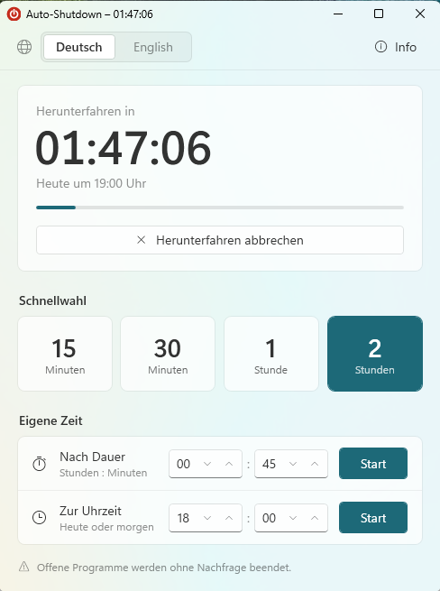
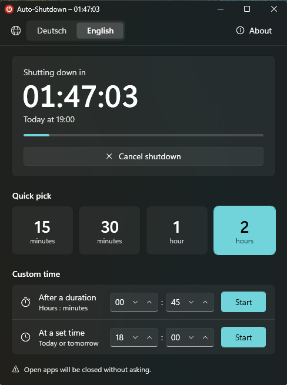

# Auto-Shutdown

Ein kleiner Shutdown-Timer für Windows 11: Computer nach 15 Minuten, 30 Minuten, 1 oder 2 Stunden herunterfahren – oder nach einer eigenen Dauer bzw. zu einer festen Uhrzeit. Im Design von Windows 11, mit Mica-Hintergrund, Hell-/Dunkelmodus und der Akzentfarbe des Systems.

*English: A tiny Windows 11 shutdown timer with a German and English UI. Pick 15 min, 30 min, 1 h, 2 h, a custom duration or a clock time – the PC shuts down automatically. Native Windows 11 look, resizable up to full screen, no installation, single ~70 KB exe.*

<p align="center">
  
  &nbsp;
  
</p>

## Funktionen

- **Schnellwahl** mit einem Klick: 15 Min, 30 Min, 1 Std, 2 Std
- **Eigene Zeit**: beliebige Dauer (bis 99:59 Std) oder feste Uhrzeit (heute bzw. morgen, falls schon vorbei)
- **Countdown** mit Fortschrittsbalken, auch in der Taskleiste
- **Abbrechen** jederzeit mit einem Klick
- **Deutsch und Englisch** – umschaltbar in der oberen Leiste, die Wahl wird gespeichert (beim ersten Start gilt die Sprache von Windows)
- **Info-Fenster** mit Version, Ersteller und Lizenz
- **Frei vergrösserbar** bis Vollbild – Text und Buttons wachsen mit, die Startgrösse ist die Mindestgrösse
- Fenster schliessen ist möglich – der Timer läuft weiter, und beim erneuten Öffnen wird der Countdown wieder angezeigt
- Passt sich automatisch an **Hell-/Dunkelmodus** und **Akzentfarbe** von Windows an
- Keine Installation, keine Admin-Rechte, kein Internet, keine Telemetrie

## Download

Die aktuelle `AutoShutdown.exe` gibt es unter [**Releases**](../../releases/latest). Am besten in einen eigenen Ordner legen (nicht direkt im Download-Ordner starten) und per Doppelklick öffnen.

> **Hinweis zur Windows-Warnung:** Die exe ist (noch) nicht digital signiert. Windows SmartScreen zeigt deshalb beim ersten Start „Der Computer wurde durch Windows geschützt“. Über **Weitere Informationen → Trotzdem ausführen** lässt sie sich starten. Wer sichergehen will, kann die Datei selbst aus dem Quellcode bauen (siehe unten) oder die Prüfsumme vergleichen:
>
> ```powershell
> Get-FileHash .\AutoShutdown.exe -Algorithm SHA256
> ```
>
> Der Wert muss mit dem Inhalt von `AutoShutdown.exe.sha256` im Release übereinstimmen.

## Selbst bauen

Es wird **kein Visual Studio und kein .NET SDK** benötigt – der C#-Compiler von .NET Framework 4.8 ist in Windows bereits enthalten.

```powershell
powershell -ExecutionPolicy Bypass -File build.ps1
```

Das Ergebnis liegt danach in `dist\AutoShutdown.exe` (plus Prüfsumme `AutoShutdown.exe.sha256`).

Optional mit eigenem Code-Signing-Zertifikat signieren (inkl. Zeitstempel):

```powershell
powershell -ExecutionPolicy Bypass -File build.ps1 -CertificateThumbprint <Fingerabdruck>
```

Jeder Push wird ausserdem per GitHub Actions gebaut. Ein Tag wie `v1.0.0` erstellt automatisch ein Release mit exe und Prüfsumme.

## So funktioniert es

Auto-Shutdown nutzt den Windows-eigenen Befehl `shutdown`:

| Aktion | Befehl |
|---|---|
| Herunterfahren planen | `shutdown /s /t <Sekunden>` |
| Abbrechen | `shutdown /a` |

> **Achtung:** Bei einem zeitgesteuerten Herunterfahren schliesst Windows offene Programme **ohne Nachfrage**. Nicht gespeicherte Arbeit geht verloren.

Ein geplantes Herunterfahren lässt sich auch ohne das Programm abbrechen: `shutdown -a` in der Eingabeaufforderung.

Gespeichert wird nur in `%LOCALAPPDATA%\AutoShutdown\`:

| Datei | Inhalt |
|---|---|
| `geplant.txt` | geplanter Zeitpunkt, nur für die Anzeige des Countdowns |
| `sprache.txt` | gewählte Sprache (`de` oder `en`) |

## Sicherheit

- `shutdown.exe` wird immer über den vollständigen Pfad in `System32` gestartet – nie über den Suchpfad.
- An `shutdown.exe` werden nur feste Schalter und eine selbst berechnete Zahl übergeben, nie Text aus einer Eingabe.
- Native DLLs werden nur aus `System32` geladen (Schutz gegen DLL-Hijacking).
- Die Oberfläche (XAML) ist in die exe eingebettet und wird nicht von der Festplatte nachgeladen.
- Die gespeicherten Dateien werden streng geprüft (Grösse, Format, Plausibilität; bei der Sprache nur `de` oder `en`). Sie können nie selbst ein Herunterfahren auslösen.
- Läuft ohne Admin-Rechte (`asInvoker`), ohne Netzwerkzugriff.
- Die GitHub Actions sind auf feste Commit-IDs gepinnt und laufen mit minimalen Rechten.

Sicherheitsprobleme bitte über **Security → Report a vulnerability** im Repository melden, nicht als öffentliches Issue.

## Systemvoraussetzungen

- Windows 11 (getestet mit Build 26300). Der Mica-Hintergrund benötigt Windows 11 22H2 oder neuer, ältere Versionen erhalten einen einfarbigen Hintergrund.
- Windows 10 sollte funktionieren, ist aber noch nicht getestet.
- .NET Framework 4.8 (in Windows 10 und 11 vorinstalliert)

## Lizenz

[MIT](LICENSE) – frei nutzbar, ohne Gewähr.
